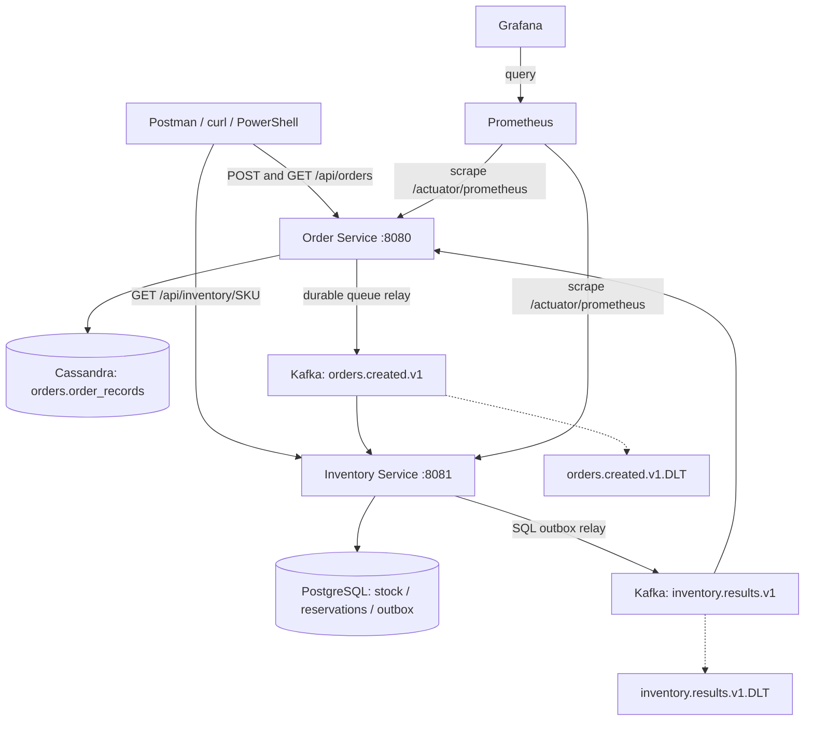

# Spring Boot + Kafka: Cassandra Orders and PostgreSQL Inventory

A runnable Java 21 / Spring Boot 3.5.7 backend demo with two independently persisted services:

- **Order Service:** Cassandra, conditional writes (LWT), and a durable partition-local event queue.
- **Inventory Service:** PostgreSQL, JDBC transactions, conditional stock updates, and a SQL transactional outbox.
- **Communication:** Kafka events with at-least-once delivery and idempotent business processing.
- **Operations:** Docker Compose, Actuator, Micrometer, Prometheus, Grafana, and GitHub Actions.

This is a learning and interview project. It does not describe any employer's production architecture or claim unmeasured performance improvements. There is no Kubernetes deployment, Spring Cloud dependency, Redis cache, or Resilience4j circuit breaker in this repository.

## Architecture



Both topics and both DLTs share one Kafka broker in this demo. Compose starts seven long-running containers plus a one-shot Cassandra schema initialization job. Each service owns its database; Inventory never queries Cassandra and Order never queries PostgreSQL.

## Technology stack

| Area | Technology |
|---|---|
| Runtime | Java 21, Spring Boot 3.5.7, Spring MVC, Maven |
| Orders | Spring Boot Data Cassandra starter, Cassandra Java driver / CqlSession, Cassandra 4.1.10 |
| Inventory | Spring JDBC, PostgreSQL 17.6, Flyway |
| Events | Spring Kafka, Apache Kafka 3.9.1 |
| Monitoring | Actuator, Micrometer, Prometheus, Grafana |
| Tests | JUnit 5, Mockito, Testcontainers 1.21.4, Postman/Newman |
| Deployment | Docker Compose; GitHub Actions for integration and full-stack checks |

Order uses prepared CQL through the auto-configured `CqlSession`. The Cassandra starter is scoped to Order; PostgreSQL/JDBC/Flyway dependencies are scoped to Inventory. The common module contains only shared events, decoding, and Kafka configuration.

## Quick start

Install and start Docker Desktop / Docker Engine with Linux containers and Compose v2. Allow approximately 4 GB or more for the Docker workload; Cassandra startup and first-time image downloads can take several minutes. The host does not need Java or Maven for the Docker build.

```bash
docker compose config --quiet
docker compose up -d --build --remove-orphans
docker compose ps -a
docker compose logs -f order-service inventory-service
```

Expected state: Cassandra, PostgreSQL, and Kafka healthy; `cassandra-init` exited with code 0; both applications running. A successful init job is intentionally not a continuously running service. The init job executes the idempotent `schema.cql` before Order starts; Inventory applies Flyway migrations on startup.

```bash
curl http://localhost:8080/actuator/health
curl http://localhost:8081/actuator/health
python scripts/smoke.py
```

The default sample SKU is `DEMO-SKU`, initially stocked with 100 units in a new Inventory database. Existing volumes retain previous orders/reservations and stock changes. Use new order IDs for new business requests. The same ID and payload represent a retry, not another order.

### Windows and configurable Grafana port

If Windows reserves port 3000, create `.env` in the project root containing `GRAFANA_PORT=13000` (see `.env.example`), then restart Compose. Open http://localhost:13000/d/microservices-demo and run:

```powershell
python scripts/smoke.py --grafana-url http://localhost:13000
```

The PowerShell demo calls the same HTTP API:

```powershell
.\scripts\demo.ps1
```

### Upgrading the previous PostgreSQL-only version

This change replaces the **Order database implementation**, not the Inventory database. `--remove-orphans` removes the old Order PostgreSQL container. Its named data volume is not deleted by this command. There is **no automatic migration of old PostgreSQL orders into Cassandra**: old IDs will return 404 until explicitly imported. Inventory's existing PostgreSQL volume and reservations remain intact. Use fresh order IDs for the migrated demo.

This repository does not delete the legacy Order volume or reset Inventory stock during startup. For a production migration, plan data export/import, historical reservation reconciliation, event cutover, and rollback separately.

## Calling the API in Postman

The applications must be running first. Postman sends HTTP requests; it does not start Java, Cassandra, or Docker.

### Import the ready-to-run collection

1. In Postman, choose **Import** and import `postman/microservices.postman_collection.json`.
2. Import `postman/local.postman_environment.json` and select the **Local Microservices** environment.
3. Check `orderBaseUrl=http://localhost:8080` and `inventoryBaseUrl=http://localhost:8081`. The environment contains no authentication credentials.
4. Run the collection in order with a **1000 ms request delay**. It creates its own order IDs, waits for terminal results, checks idempotency/stock, and tests 409/400/404 responses and an unknown-SKU rejection.
5. Ensure `DEMO-SKU` has at least one available unit. Each successful collection run consumes one unit. Avoid concurrent clients while asserting exact stock changes.

`Wait for order result` and `Wait for rejection` use bounded collection-runner polling (up to 60 requests). When using **Send** manually, `setNextRequest` does not run another request automatically: resend the GET until its status is terminal.

### Create an order manually

In Postman select **New → HTTP Request**:

```http
POST {{orderBaseUrl}}/api/orders
Content-Type: application/json
```

Select **Body → raw → JSON**:

```json
{
  "orderId": "{{$guid}}",
  "sku": "DEMO-SKU",
  "quantity": 1
}
```

Click **Send**. The response is `202 Accepted`, usually with `PENDING`, and includes `id`, `sku`, `quantity`, `status`, and `created_at`. Copy the returned `id` into the collection variable `orderId` or into the URL below. A fast asynchronous completion may already be visible in a response; 202 itself is acceptance, not a guarantee of inventory confirmation.

### Query the final order and stock

```http
GET {{orderBaseUrl}}/api/orders/{{orderId}}
GET {{inventoryBaseUrl}}/api/inventory/DEMO-SKU
```

The order eventually becomes `CONFIRMED` or `REJECTED`. A successful one-unit order reduces stock by one. Querying an unknown ID returns 404. A browser address bar can issue the GET requests, but use Postman/curl/a frontend for POST JSON.

### Demonstrate retries, conflicts and validation

| Request | Expected result |
|---|---|
| Same orderId, SKU and quantity | 202 with the existing order; no additional stock deduction |
| Same orderId but a different quantity or SKU | 409 Conflict |
| New ID, unknown SKU | 202, then REJECTED; no stock deduction |
| New ID, quantity 1000 for the initially 100-unit SKU | 202, then REJECTED |
| Quantity 0 or greater than 1000; invalid SKU or UUID | 400 Bad Request |

For manual retries, paste the **same concrete UUID** in the body. Leaving `{{$guid}}` in the body generates a new ID on each Send, which intentionally creates a different order.

### curl alternative (Bash)

```bash
curl -i -X POST http://localhost:8080/api/orders \
  -H 'Content-Type: application/json' \
  -d '{"orderId":"11111111-1111-4111-8111-111111111111","sku":"DEMO-SKU","quantity":1}'
curl http://localhost:8080/api/orders/11111111-1111-4111-8111-111111111111
curl http://localhost:8081/api/inventory/DEMO-SKU
```

On Windows use `curl.exe` or the PowerShell demo to avoid the legacy PowerShell curl alias. The collection uses the same API paths and JSON contract.

## Cassandra data model and correctness

The schema is in `order-service/src/main/resources/schema.cql`. Keyspace `orders` uses `NetworkTopologyStrategy` with replication factor 1 in `datacenter1` for this single-node demo.

```cql
PRIMARY KEY ((shard), kind, order_id)
```

`shard = floorMod(UUID.hashCode(), 16)` is a fixed persistent partitioning contract. `kind='ORDER'` holds order state. `kind='EVENT'` holds the durable pending creation event. Both rows for an order live in the **same table and partition**.

### Creating an order

`CassandraOrderStore.insertWithEvent` uses a **single-partition conditional batch**:

```cql
BEGIN BATCH
  INSERT INTO order_records (...) VALUES (..., 'ORDER', ...) IF NOT EXISTS;
  INSERT INTO order_records (...) VALUES (..., 'EVENT', ...);
APPLY BATCH;
```

The snippets above explain the operation; the executable prepared CQL is in `CassandraOrderStore.java`. The condition applies to the whole batch: if the order already exists, neither row is written. Thus a retry cannot overwrite an existing order or recreate a creation event already published and removed. The service then reads the stored immutable request fields and returns 409 for a conflicting payload. Ordinary last-write-wins upserts alone would not provide this behavior.

### Finding and publishing pending events

The relay queries each known shard with `kind='EVENT'`, using the partition key and clustering prefix, without `ALLOW FILTERING`, a full-cluster scan, or a separately maintained queue index. It rotates across shards and publishes at most 20 events per pass. After Kafka acknowledges a send, it deletes only the EVENT row. The ORDER row remains queryable.

Kafka send failure leaves the event durable. A crash or Cassandra delete failure after Kafka acknowledgment can resend an event. Multiple relay instances can also send the same event; the relay deliberately has no distributed lease. Inventory deduplicates by order ID. These are **at-least-once semantics**, not an exactly-once transaction across Cassandra, Kafka, and PostgreSQL.

### Consuming inventory results

The Order consumer validates the original SKU and quantity, then uses LWT `IF status='PENDING'` to accept only one terminal transition. An identical repeated result is harmless; a contradictory terminal result is rejected to the DLT path instead of silently rewriting the outcome. Driver requests use `LOCAL_QUORUM` and LWT serial consistency `LOCAL_SERIAL`; a one-node/RF1 demo does not demonstrate replica failover.

### Modeling tradeoffs

The 16-shard layout makes pending-event discovery explicit and demonstrable. It is **not a production scale claim**: partitions grow with retained orders, and LWT contention is partition-scoped. Do not change SHARDS without migrating existing data. Production designs need capacity/partition-size measurements, retention or time-bucket design, repair/tombstone planning, and possibly CDC or a dedicated dispatch pipeline. Cassandra does not provide the former JDBC transaction manager, SQL joins, or `FOR UPDATE SKIP LOCKED` here.

## Inventory transactions and Kafka failure handling

Inventory still executes one PostgreSQL transaction for: inserting the reservation marker, conditional stock deduction, and writing the result outbox. Its unique order ID marker rolls back with stock and outbox on error.

```sql
UPDATE stock SET available=available-?
WHERE sku=? AND available>=?;
```

Inventory's SQL relay publishes acknowledged events and deletes them within its own transaction. Kafka record offsets are committed after listener success. A crash after database persistence and before offset commit can replay a record; business deduplication handles that window.

Events on `orders.created.v1` and `inventory.results.v1` carry `orderId`, `sku`, `quantity`, and `status`; the Kafka key is orderId. Insufficient stock/unknown SKU is a normal `REJECTED` business outcome. Invalid JSON/events go directly to `<topic>.DLT`; other consumer failures get two retries one second apart before DLT recovery. Failed DLT publication is not treated as a successful recovery. DLT messages require investigation and deliberate replay; long-lived PENDING reconciliation is not implemented.

### Broker outage demo

1. Run `docker compose stop kafka`.
2. Submit a fresh order in Postman. While Cassandra is healthy, the API accepts it and the order remains PENDING.
3. Inspect pending rows, for example: `docker compose exec cassandra cqlsh -e "SELECT * FROM orders.order_records WHERE shard=0 AND kind='EVENT';"`. An order can belong to any shard 0–15; an empty shard is not proof of an empty queue. In a disposable demo, a full `SELECT * FROM orders.order_records` can help inspect both row types.
4. Observe Outbox failure counters in Grafana, then run `docker compose start kafka`.
5. Query the **same** order ID until CONFIRMED/REJECTED; its EVENT row is removed after publication. The failure counter is cumulative and will not reset on recovery.

The API's Cassandra write can itself fail during a database outage; it must not report a successful acceptance when persistence has failed. Retrying with the same ID resolves uncertain client timeouts through the conditional create.

## Monitoring

Open [Prometheus targets](http://localhost:9090/targets) and [Grafana](http://localhost:3000/d/microservices-demo), or port 13000 when overridden. Grafana credentials are `admin / demo-admin` for local use only. Provisioning configures the Prometheus datasource and eight dashboard panels automatically.

Actuator/Micrometer expose JVM/HTTP metrics and custom order, inventory, and outbox counters. Prometheus scrapes both services every five seconds; Grafana queries Prometheus. HTTP histograms support p95 queries, but HTTP acceptance latency is not asynchronous order-completion latency. Service `up` means metrics are reachable, not that the whole Kafka workflow is healthy. Business counters are in-memory observations and reset on process restart; the owning databases are the source of business truth.

```bash
python scripts/load.py --requests 100 --concurrency 10
```

This helper uses an unknown SKU and measures HTTP acceptance only, not completed-order throughput or scalability. Current gaps include pending-age/queue-depth metrics, Kafka lag alerts, completion-latency histograms, and automated stuck-order reconciliation.

## Build, tests and CI

For a host build, install JDK 21 and Maven 3.9+. Container integration tests require a running Docker engine.

```bash
mvn -B clean verify
mvn -B verify -Pintegration
docker compose config --quiet
docker compose up -d --build --remove-orphans
python scripts/smoke.py
npx --yes newman@6.2.1 run postman/microservices.postman_collection.json --delay-request 1000
```

Order's Testcontainers suite uses **real Cassandra and Kafka** and checks conditional batch creation, concurrent duplicate requests, event retention/replay, terminal-state CAS, the HTTP contract, and Kafka results. Inventory's suite continues to use real PostgreSQL/Kafka for deduplication, concurrency/no oversell, transaction rollback, and DLT handling. Unit tests cover business decisions and relay failures. Integration tests fail rather than silently skip when Docker is unavailable.

GitHub Actions runs tests, builds/starts Compose, runs full smoke, and executes the Postman collection through Newman. It uploads reports/logs and removes only its own CI test volumes afterward. Current execution evidence is in [VALIDATION.md](VALIDATION.md); legacy PostgreSQL-only evidence is not a Cassandra validation result.

## Reading and presenting the project

Read `OrderApi` → `Orders` → `CassandraOrderStore` → `CassandraOutboxRelay` → `Inventory` → Inventory's `Outbox` → `Messaging` → integration tests. In a 10-minute demo, show normal confirmation, replay without another deduction, a 409 conflict, business rejection, broker outage/recovery, and Grafana. Explain why order and queue rows share a Cassandra partition and why Inventory retains a relational transaction.

## Local operation and limits

Host ports bind only to 127.0.0.1. Database authentication/TLS and API authentication are not configured for public production use. The single broker and single Cassandra node provide no high availability. There are no payment, cancellation, inventory-release, replenishment APIs, multi-item orders, distributed tracing, or schema-registry integration.

`docker compose down` stops the stack and keeps named data volumes. **`docker compose down -v` deletes this stack's current database and Kafka volumes**; use it only for an intentional demo reset. If Docker Desktop's disk image is stored under this project's ignored `work/docker-storage`, it is persistent Docker data: move it in Docker Desktop settings before deleting the project/work directory.

References: [Cassandra conditional writes and batches](https://cassandra.apache.org/doc/stable/cassandra/developing/cql/dml.html), [Spring Boot Cassandra configuration](https://docs.spring.io/spring-boot/3.5/reference/data/nosql.html), [Testcontainers Cassandra](https://java.testcontainers.org/modules/databases/cassandra/), [Spring Kafka error handling](https://docs.spring.io/spring-kafka/reference/kafka/annotation-error-handling.html).
