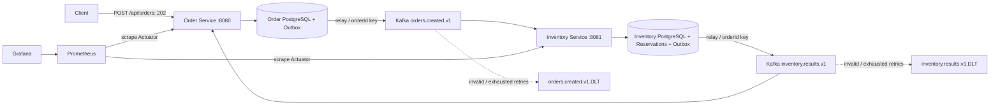
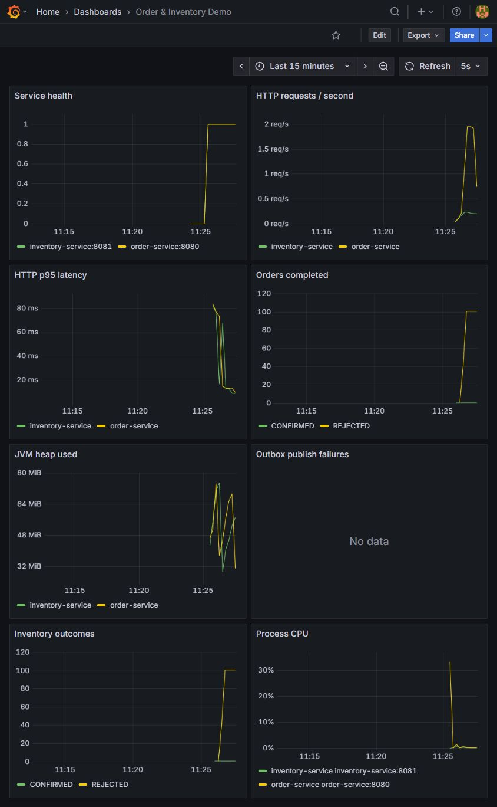

# Spring Boot Kafka Microservices Demo

Java 21 / Spring Boot 3.5.7 学习项目：Order Service 接受订单，Inventory Service 异步预留库存，并将结果发送回订单服务。两个服务各自拥有 PostgreSQL 数据库，通过 Kafka 通信。

> 这是独立学习项目，不代表 Walmart、Intuit 或任何实际雇主的生产系统；不包含未经测量的性能提升或工作经历声明。

## 架构



项目使用 JDBC + Flyway，使事务边界、条件更新和幂等逻辑清晰可见。Spring Boot 可以独立构建微服务；Spring Cloud 是可选组件，本项目使用 Compose DNS 和 Kafka，无需强行加入服务发现或网关。

## 一键启动

需要运行中的 Docker Engine / Docker Desktop（Linux containers），Compose v2，建议给 Docker 分配至少 4 GB 内存和足够镜像空间。首次启动需要下载镜像及 Maven 依赖。

```bash
docker compose config --quiet
docker compose up -d --build
docker compose logs -f order-service inventory-service
```

等待两个服务日志出现 `Started ...Application`；API 端口可用后检查：

```bash
curl http://localhost:8080/actuator/health
curl http://localhost:8081/actuator/health
python scripts/smoke.py
```

所有宿主机端口仅绑定 `127.0.0.1`。数据库账号 `demo/demo`、Grafana `admin/demo-admin` 仅供本地演示。没有登录鉴权、TLS 或多副本容错，不应直接用于公开部署。

停止：`docker compose down`。数据库及 Kafka 数据保存在命名卷。**`docker compose down -v` 会删除本项目订单、库存和 Kafka 数据**，仅在需要重置演示数据时使用。

### Windows 端口被系统保留时

如果 Grafana 启动报 3000 端口被拒绝，可运行 `netsh interface ipv4 show excludedportrange protocol=tcp` 检查。可在项目根目录 `.env` 写入 `GRAFANA_PORT=13000`，重新执行 `docker compose up -d --build`，然后访问 http://localhost:13000/d/microservices-demo 。完整检查使用 `python scripts/smoke.py --grafana-url http://localhost:13000`。无需修改 Windows 的端口保留规则。

测试依赖使用 Testcontainers 1.21.4，兼容 Docker 29 的较新 API 要求。Windows 若需显式指定 Docker 后端，可在 PowerShell 设置 `$env:DOCKER_HOST='npipe:////./pipe/dockerDesktopLinuxEngine'` 后运行集成测试。

## API / curl 示例

下列 curl 使用 Bash 语法。在 PowerShell 中可使用随附的 `scripts/demo.ps1`；Windows 上请使用 `curl.exe`，避免旧版 PowerShell 的同名别名。

```bash
# 1. 初始库存 DEMO-SKU = 100
curl http://localhost:8081/api/inventory/DEMO-SKU

# 2. 客户端生成订单 UUID；同一个 UUID 同一个请求即为幂等重试
curl -i -X POST http://localhost:8080/api/orders \
  -H 'Content-Type: application/json' \
  -d '{"orderId":"11111111-1111-4111-8111-111111111111","sku":"DEMO-SKU","quantity":2}'

# 3. POST 返回 202，异步状态从 PENDING 转为 CONFIRMED
curl http://localhost:8080/api/orders/11111111-1111-4111-8111-111111111111
curl http://localhost:8081/api/inventory/DEMO-SKU

# 4. 超过初始库存：最终为 REJECTED，库存不减少
curl -X POST http://localhost:8080/api/orders \
  -H 'Content-Type: application/json' \
  -d '{"orderId":"22222222-2222-4222-8222-222222222222","sku":"DEMO-SKU","quantity":1000}'
```

重复发送第 2 个请求不会重复扣库存；把相同 orderId 的 quantity 改为 3 返回 `409`。quantity 必须为 1–1000，非法请求返回 `400`；不存在的订单返回 `404`；未知 SKU 的订单会异步 `REJECTED`。SKU 只允许 1–64 个字母、数字、下划线和连字符。POST 幂等重放仍返回 202，body 可能已包含最终状态。

## Kafka 事件流程与正确性

事件 JSON（两个 topic 使用相同结构，topic 名中的 v1 表示当前契约版本）：

```json
{"orderId":"11111111-1111-4111-8111-111111111111","sku":"DEMO-SKU","quantity":2,"status":"PENDING"}
```

1. Order Service 在一个数据库事务内插入 `orders(PENDING)` 和 `outbox`。主键冲突时读取原订单，同 payload 返回原结果，不同 payload 返回 409。
2. Outbox relay 每秒查询一批待发送记录，`FOR UPDATE SKIP LOCKED` 避免多个 relay 同时发送同一行。Kafka send 确认成功后删除记录并提交；发送失败则回滚，下一轮继续。
3. Inventory 消费 created 事件，在一个事务内插入以 orderId 为主键的 reservation、执行 `UPDATE stock SET available=available-? WHERE sku=? AND available>=?`、写入结果 Outbox。重复事件不会再次扣库存；并发条件更新及数据库非负约束防止超卖。
4. 结果事件的 status 为 `CONFIRMED` 或 `REJECTED`。Order 消费时校验 SKU 和数量，只允许 `PENDING` 更新为最终状态。重复结果没有额外业务副作用。
5. Kafka offset 在记录处理成功后提交。数据库事务提交后、offset 提交前崩溃可能重放；业务幂等用于处理这一窗口。

这实现的是 **at-least-once 投递 + 幂等业务效果**，不是跨 PostgreSQL 和 Kafka 的 exactly-once。Relay 在 broker 确认后、数据库提交前崩溃会重复发送；producer idempotence 不能消除 relay 重启后的业务重复。Outbox 失败会持续保留，成功发送的 Outbox 行会删除。单批发送暂时持有数据库行锁，适合本演示；生产可采用 CDC/租约 relay、退避和更完善的积压告警。

库存不足是业务结果，不重试、不进入 DLQ。消费者临时异常最多重试两次（首次处理 + 两次重试，间隔一秒）。非法 JSON/事件立即进入 `<topic>.DLT`。DLT 保留原始 payload、key 和错误 headers，分区数与源 topic 相同；发送 DLT 失败会抛出错误，不按已成功恢复处理。DLT 消息不自动重放；需要排查原始异常、修复原因并手工按原 key 重放。下游订单可能因此一直 PENDING，需要运维对账，本项目没有自动对账任务。

### 观察消息与 DLQ

```bash
docker compose exec kafka /opt/kafka/bin/kafka-console-consumer.sh --bootstrap-server kafka:19092 --topic inventory.results.v1 --from-beginning --timeout-ms 10000
echo '{broken' | docker compose exec -T kafka /opt/kafka/bin/kafka-console-producer.sh --bootstrap-server kafka:19092 --topic orders.created.v1
docker compose exec kafka /opt/kafka/bin/kafka-console-consumer.sh --bootstrap-server kafka:19092 --topic orders.created.v1.DLT --from-beginning --timeout-ms 10000
```

### Broker 故障演示

执行 `docker compose stop kafka`，提交新 UUID 的订单：数据库正常时 API 仍接受并写为 PENDING。检查数据库 Outbox：

```bash
docker compose exec order-db psql -U demo -d demo -c "select id,topic,event_key from outbox;"
docker compose start kafka
```

恢复后 relay 重发，订单最终完成。Actuator health 此处主要反映进程/数据库，并不保证 Kafka 或整个业务链路健康。

## 监控 Dashboard 演示

1. 打开 [Prometheus Targets](http://localhost:9090/targets)，等待两个 target 均为 UP。
2. 打开 [Grafana Dashboard](http://localhost:3000/d/microservices-demo)，登录 `admin/demo-admin`。数据源和 dashboard 自动配置。
3. 运行 `python scripts/load.py --requests 100 --concurrency 10`，观察请求速率和 p95 延迟。
4. 对比成功和拒绝订单计数；停止 Kafka 后观察 Outbox publish failures，恢复后观察订单完成。
5. 观察 JVM heap、process CPU 和 service up。无业务请求时 p95 可能无数据；计数器首次发生事件后才出现。指标不是测试覆盖率。

包含 8 个面板：服务抓取状态、HTTP RPS、HTTP p95、订单结果、JVM heap、Outbox 发送失败、库存预留结果、CPU。业务计数器是进程内观测数据，重启归零，极少数事务回滚也可能已经计数；数据库是业务事实来源。



## 构建与测试

本机需要 JDK 21、Maven 3.9+；Docker 构建不要求宿主机安装 Java/Maven。

```bash
mvn -B verify                 # 编译、10 个 JUnit/Mockito 单元测试、两个可执行 JAR
mvn -B verify -Pintegration   # 另外执行 Testcontainers 集成测试；需要 Docker
docker compose config --quiet
docker compose up -d --build
python scripts/smoke.py       # 实际两个服务的 HTTP/Kafka/数据库闭环 + 监控健康
```

单元测试涵盖新建订单 Outbox、幂等重放、请求冲突、非法结果、库存确认/拒绝、重复消费、非法事件、broker 失败保留 Outbox。Testcontainers 测试涵盖 Flyway + PostgreSQL + Kafka、订单最终状态、库存幂等、并发不超卖、数据库失败回滚、非法消息进入 DLT。未启用静默跳过 Docker 的配置：运行 integration profile 没有 Docker 时会失败。

GitHub Actions 配置为 Java 21 构建、Testcontainers 测试、Compose 配置检查、容器启动和 smoke。失败时上传日志，最后清理测试卷。是否通过以该次 Actions 运行结果为准；本次本地检查结果见 [VALIDATION.md](VALIDATION.md)。

### 性能实验

`scripts/load.py` 只统计创建订单 API 的 HTTP 接受速率、p95、错误数；它使用未知 SKU，不消耗演示库存。202 是接收成功，不代表库存业务已完成。脚本的数字不证明系统可扩展，也不能直接写为生产性能提升。逐步增加并发，结合错误率、CPU、JVM 和异步积压观察；服务扩容后需要重复测量才可讨论扩展效果。

## 导师 Demo 讲解要点（约 10 分钟）

- 0–2 分钟：解释为什么按订单和库存划分服务、为什么每个服务拥有独立数据库。Cloud-native 强调可部署、可观测和自动化，不等于一定使用 Spring Cloud。
- 2–4 分钟：提交订单，说明 202 / PENDING 与最终 CONFIRMED 的区别，展示数据库和 Kafka 消息。
- 4–6 分钟：重发同一订单，说明 producer idempotence 与业务幂等的区别；演示库存不足、原子条件更新如何避免超卖。
- 6–8 分钟：停止 broker，演示 Outbox 的恢复；展示 DLQ，并解释 Retry、DLQ 与 Circuit Breaker 的不同用途。本项目没有同步远程 HTTP 依赖，因此没有为堆技术加入 Resilience4j Circuit Breaker。
- 8–10 分钟：展示 Grafana、JUnit/Mockito 与 Testcontainers 的区别；解释吞吐量、p95 和测试覆盖率。可用 JVM 指标定位症状，再用 thread dump/heap dump 验证原因，不能仅凭图表宣称解决了内存泄漏。

面试准备：能说明事务提交失败、重复消息、broker 不可用、DLQ 发送失败、订单长期 PENDING 的处理边界。当前不支持取消、补偿、支付、库存补货及事件 schema registry；这些是后续扩展，不是本演示已实现的功能。

## 手工上传 GitHub（连接无法写入时）

在本项目根目录执行；请先确认远端仓库地址属于自己。若远端已有 README，优先先克隆仓库，再把本项目源码复制进去后提交，以保留远端历史。

```bash
git clone https://github.com/nz284/springboot-kafka-microservices-demo.git
# 将交付源码复制到克隆目录，不复制 target、work、数据库数据或任何凭据
cd springboot-kafka-microservices-demo
git add .
git commit -m "Add runnable Java 21 order and inventory microservices"
git push origin HEAD
```

参考：[Spring Boot 3.5 requirements](https://docs.spring.io/spring-boot/3.5/system-requirements.html)、[Spring Kafka error handling](https://docs.spring.io/spring-kafka/reference/kafka/annotation-error-handling.html)、[Testcontainers Kafka](https://java.testcontainers.org/modules/kafka/)。
